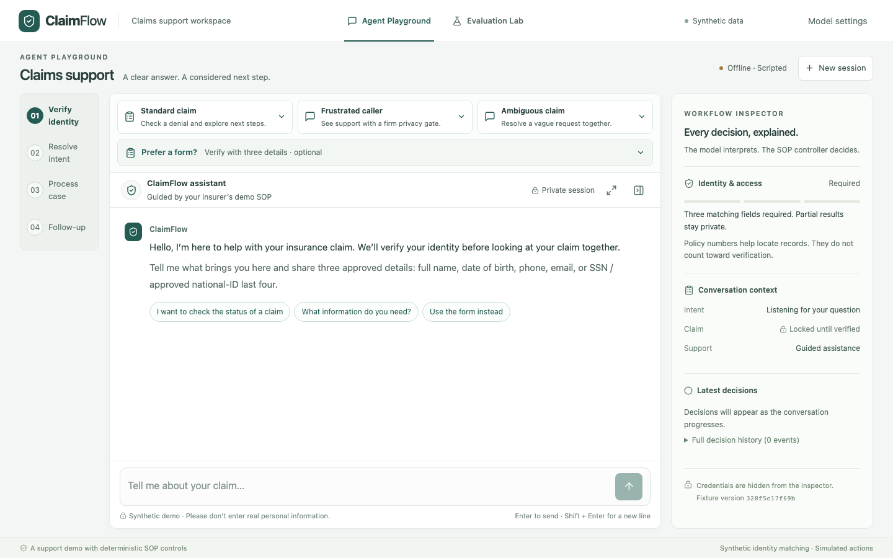

# ClaimFlow — Insurance SOP Agent

An insurance support workspace that pairs natural-language conversation with a deterministic SOP controller. Walk through identity verification, explore a fictional claim with source-backed answers, and review a summary before explicitly choosing Send or Skip. The Workflow Inspector makes each policy decision visible; the Evaluation Lab makes it testable.

**[Live demo](https://claimflow-demo.onrender.com/)** · [Usage](docs/USAGE.md) · [Validation](docs/VALIDATION.md) · [Architecture](docs/ARCHITECTURE.md)

**Starts offline. No API key needed for guided scenarios.** The hosted demo is manually deployed and may lag this repository; the screenshots below show the local version.


## Why it matters

Insurance support needs more than a fluent answer: it needs controlled access to records, grounded explanations, and explicit consent. ClaimFlow separates language interpretation from authority. The model proposes a typed interpretation; deterministic Python code controls identity matching, authorization, record reads, workflow transitions, factual responses, and simulated follow-up.

## Key features

- **Three-field identity gate:** three distinct approved details must match one synthetic policyholder. Policy numbers do not count; partial matches stay private.
- **Deterministic SOP:** verify identity → resolve intent → process case → follow-up. Ambiguity, conflicting identity, representative requests, and expired deadlines retain their safety gates.
- **Grounded support:** explain recorded denials, document requirements and alternatives, payments, and next steps using the supplied fixtures and guidance.
- **Demo-friendly Playground:** guided scenarios, optional verification form, standard and expanded layouts, and state-aware prompt chips that fill an editable draft without an extra model call.
- **Inspectable and testable:** Workflow Inspector with source evidence and decision history; Evaluation Lab with 23 isolated scripted policy scenarios.
- **Explicit summary consent:** preview the authorized discussion, then Send a simulated email or Skip. New questions invalidate the preview and require fresh consent.
- **Offline or BYOK:** use the limited offline parser, or select a supported OpenAI, Anthropic, or Gemini model in Model settings. Keys stay server-side in encrypted session state.

## Try the workflow

With Docker installed:

```sh
cp -n .env.example .env
docker compose up --build
```

Open [localhost:8000](http://localhost:8000).

1. Open **Try a guided scenario** in the Playground and use **Standard Claim**. Its fictional opening fills the composer; review it and send.
2. Follow the grounded response and inspect the identity gate, current claim, sources, and latest decisions. Try **Explain the denial** or **What documents do I need?**; prompt chips fill a draft for you to review.
3. Select **Expand playground** for a taller conversation, then **Review summary** and explicitly choose **Send simulated email** or **Skip**.
4. Open **Evaluation Lab** and run a scenario to compare expected behavior with observed decisions. Runs are isolated from the Playground and make no model calls.

**Prefer a form?** opens the same verification gate with three editable fields. Guided scenarios also include Frustrated Caller and Ambiguous Claim. For live interpretation, open **Model settings**, enter your own API key, and choose **Validate & apply**. Connection validation makes one small paid call; live turns incur provider charges. Applying a model resets the workflow after confirmation.

See the [usage guide](docs/USAGE.md) for Python 3.11+/Node 22 setup, frontend development, key retention, and detailed controls. The [Render guide](docs/DEPLOYMENT.md) covers manual hosting and its paid compute/disk profile.

## Product and architecture

| Layer | Responsibility |
| --- | --- |
| React / Vite frontend | Playground, form, draft suggestions, Inspector, Model settings, and Evaluation Lab. Chat and inspector scroll independently; the composer stays accessible. |
| FastAPI backend | Same-origin API, session ownership, CSRF/origin checks, request deduplication, version checks, rate limits, and model budgets. |
| Model / offline layer | Produces a validated `Interpretation`. Fixed provider endpoints and a curated catalog; no model-executed tools or authority over records. |
| Deterministic controller | Enforces the SOP, three-field identity gate, scoped authorization, fixture reads, grounded responses, summary previews, and explicit consent. |
| Encrypted SQLite sessions | Stores workflow state, encrypted BYOK credentials, audit events, and simulated receipts. Saved transcript views redact identity details. |

One Docker service serves the UI and API. The six supplied synthetic fixtures are the data boundary. See [architecture and trust boundaries](docs/ARCHITECTURE.md) for authorization expiry, representative grants, consent, and persistence details.

<details>
<summary>Standard mode and Evaluation Lab</summary>

Standard mode keeps the page heading, scenario cards, form access, assistant context, and inspector visible.



The Lab replays the real controller with scripted interpretations, fixed clocks, and explicit assertions.


</details>

## Validation and engineering quality

The unchanged backend baseline passed **263 pytest cases** and **23 scripted policy scenarios**. The policy scenarios overlap pytest coverage; they are not an independent extra sample. Coverage includes unauthorized reads, identity conflicts, expiry, representative restrictions, consent, duplicate actions, settings, and recovery.

This UI revision passes the TypeScript/Vite production build and **37 Chromium journeys**, including three new checks for draft-only suggestions, form/draft preservation across modes, and expanded-layout space at five viewport sizes. Existing journeys cover verification, summaries, privacy, stale sessions, network recovery, settings, responsive navigation, and keyboard focus. See [validation evidence and limits](docs/VALIDATION.md) for the exact scope and historical Docker/live-model results.

```sh
# After installing dependencies; see docs/USAGE.md
.venv/bin/pytest
npm --prefix frontend run build
cd frontend
npx playwright install chromium
npm run test:e2e
```

## Scope and limitations

Synthetic records only. This is a portfolio prototype, not production identity assurance or an insurer integration. Real email, claim mutations, payments, appeals, document uploads, and human transfers are simulated or unavailable. Representative relationships alone never grant access; successful representative grants exist only in isolated evaluations.

The offline parser and factual response templates are deliberately bounded. Historical small OpenAI probes do not establish general conversational reliability; other providers have mocked contracts and need keyed live acceptance. Public deployment, load, real-world identity proof, and comprehensive accessibility are separate validation work. No real personal information belongs in this demo.

[Architecture](docs/ARCHITECTURE.md) · [Usage](docs/USAGE.md) · [Validation](docs/VALIDATION.md) · [Deployment](docs/DEPLOYMENT.md) · [Project plan](docs/PLAN.md) · [Original assignment](docs/ASSIGNMENT.md) · [Fixtures](docs/fixtures) · [Third-party notices](THIRD_PARTY_NOTICES.md)
