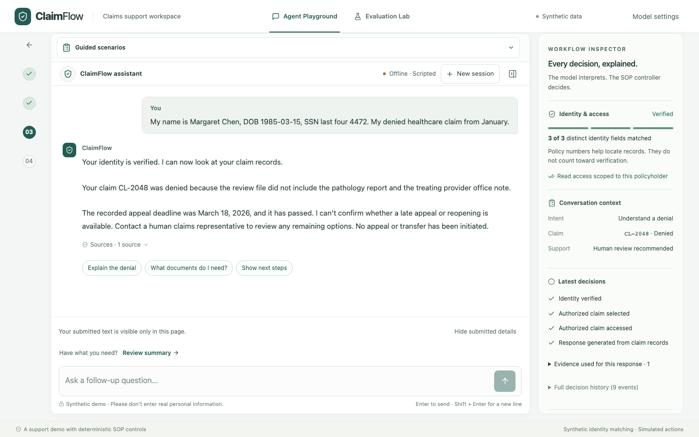
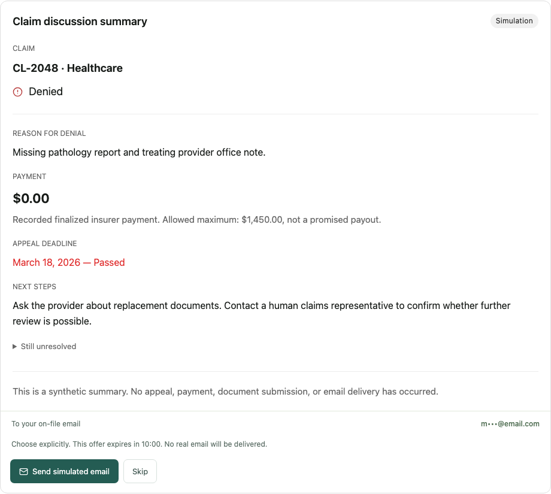
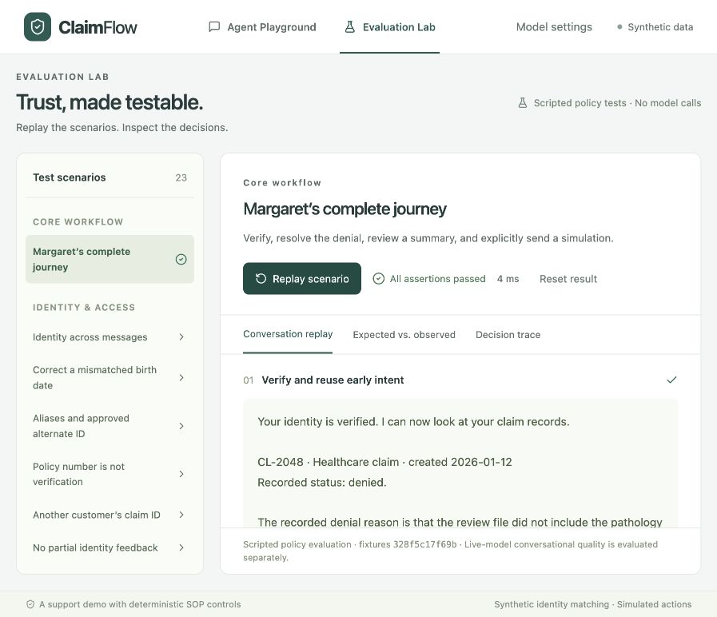

# ClaimFlow — Insurance SOP Agent

ClaimFlow helps a caller understand an insurance claim: verify identity, explain a denial, identify required documents, clarify recorded payments, and review next steps. It combines conversational support with a deterministic standard operating procedure (SOP), source-backed answers, and an explicit summary consent step. The Workflow Inspector explains decisions as they happen; the Evaluation Lab replays policy scenarios and checks the results.

**[Live demo](https://claimflow-demo.onrender.com/)** · [Usage](docs/USAGE.md) · [Validation](docs/VALIDATION.md) · [Architecture](docs/ARCHITECTURE.md)

Explore the complete workflow with fictional insurance records, or bring a supported model API key for live language interpretation. Guided scenarios run without a key.



## Why it matters

Insurance support needs more than a fluent answer: it needs controlled access to records, grounded explanations, and explicit consent. ClaimFlow separates language interpretation from authority. The model proposes a typed interpretation; deterministic Python code controls identity matching, authorization, record reads, workflow transitions, factual responses, and simulated follow-up.

## Key features

- **Three-field identity gate:** three distinct approved details must match one synthetic policyholder. Policy numbers do not count; partial matches stay private.
- **Deterministic SOP:** verify identity → resolve intent → process case → follow-up. Ambiguity, conflicting identity, representative requests, and expired deadlines retain their safety gates.
- **Grounded support:** explain recorded denials, document requirements and alternatives, payments, and next steps using the supplied fixtures and guidance.
- **Demo-friendly Playground:** guided scenarios, optional verification form, standard and expanded layouts, and state-aware prompt chips that fill an editable draft without an extra model call.
- **Inspectable and testable:** Workflow Inspector with source evidence and decision history; Evaluation Lab with 23 isolated scripted policy scenarios.
- **Explicit summary consent:** preview the authorized discussion, then Send a simulated email or Skip. New questions invalidate the preview and require fresh consent.
- **Offline or BYOK:** use the limited offline parser, or select a supported OpenAI, Anthropic, or Gemini model in Model settings. Keys stay server-side in encrypted session state.

## Try the workflow

Open the **[live demo](https://claimflow-demo.onrender.com/)**:

1. Open **Try a guided scenario** in the Playground and use **Standard Claim**. Its fictional opening fills the composer; review it and send.
2. Follow the grounded response and inspect the identity gate, current claim, sources, and latest decisions. Try **Explain the denial** or **What documents do I need?**; prompt chips fill a draft for you to review.
3. Select **Expand playground** for a taller conversation, then **Review summary** and explicitly choose **Send simulated email** or **Skip**.
4. Open **Evaluation Lab** and run a scenario to compare expected behavior with observed decisions. Runs are isolated from the Playground and make no model calls.

**Prefer a form?** opens the same verification gate with three editable fields. Guided scenarios also include Frustrated Caller and Ambiguous Claim. For live interpretation, open **Model settings**, enter your own API key, and choose **Validate & apply**. Connection validation makes one small paid call; live turns incur provider charges. Applying a model resets the workflow after confirmation.

### Review before sending

The summary separates the recorded outcome, payment, deadline, and next steps. Sending requires a current preview and an explicit choice; email delivery is simulated.



### Inspect the policy checks

Evaluation Lab replays the real controller with scripted interpretations, fixed clocks, and expected-versus-observed assertions. Its runs are isolated from the Playground and make no model calls.



## Reliability by design, checked in tests

ClaimFlow keeps access and actions under deterministic control. The model interprets the request; Python code decides whether it is authorized and renders factual answers from the supplied records.

| Control | What the checks cover |
| --- | --- |
| Identity and scoped access | Three distinct matching fields before access; no partial-match feedback; cross-policyholder requests and unsupported representative access denied. |
| Grounded answers | Denial reasons, document guidance, recorded payments, and expired deadlines come from authorized fixtures and guidance. |
| Explicit consent | Summary previews expire; further questions require a fresh preview and consent; duplicate Send requests reuse the simulated receipt. |
| Session and failure recovery | Authorization expiry, stale responses after reset, conflicting requests, failed settings changes, and network retries. |
| Inspectable behavior | Source references, decision history, and repeatable policy evaluations expose the reasoning enforced by the controller. |

Recorded validation for this codebase:

- **263/263 backend tests passed** in the unchanged backend baseline, including authorization, privacy, consent, provider contracts, and recovery.
- **23/23 scripted policy scenarios passed**, using the same evaluator as the Lab. These overlap backend tests and are not an independent extra sample.
- **37/37 Chromium journeys passed** for the Playground refresh. A later form-only revision passed **7/7 focused journeys** and the TypeScript/Vite build; it did not rerun the full suite.
- An earlier **Linux/ARM64 Docker production-profile smoke** checked request protections, a complete simulated journey, duplicate Send handling, and encrypted session/receipt persistence across restart.

These results support the tested synthetic workflow. They do not measure broad live-model conversational quality or production availability. See [validation evidence and limits](docs/VALIDATION.md) for the exact revisions, coverage, and historical live-model results.

## Run locally

With Docker installed:

```sh
cp -n .env.example .env
docker compose up --build
```

Open [localhost:8000](http://localhost:8000). See the [usage guide](docs/USAGE.md) for Python 3.11+/Node 22 setup, frontend development, key retention, and detailed controls, or the [Render guide](docs/DEPLOYMENT.md) for hosting configuration.

## Product and architecture

| Layer | Responsibility |
| --- | --- |
| React / Vite frontend | Playground, form, draft suggestions, Inspector, Model settings, and Evaluation Lab. Chat and inspector scroll independently; the composer stays accessible. |
| FastAPI backend | Same-origin API, session ownership, CSRF/origin checks, request deduplication, version checks, rate limits, and model budgets. |
| Model / offline layer | Produces a validated `Interpretation`. Fixed provider endpoints and a curated catalog; no model-executed tools or authority over records. |
| Deterministic controller | Enforces the SOP, three-field identity gate, scoped authorization, fixture reads, grounded responses, summary previews, and explicit consent. |
| Encrypted SQLite sessions | Stores workflow state, encrypted BYOK credentials, audit events, and simulated receipts. Saved transcript views redact identity details. |

One Docker service serves the UI and API. The six supplied synthetic fixtures are the data boundary. See [architecture and trust boundaries](docs/ARCHITECTURE.md) for authorization expiry, representative grants, consent, and persistence details.

## Reproduce the checks

```sh
# After installing dependencies; see docs/USAGE.md
.venv/bin/pytest
npm --prefix frontend run build
cd frontend
npx playwright install chromium
npm run test:e2e
```

## Scope and limitations

Synthetic records only. This is a portfolio prototype, not production identity assurance or an insurer integration. Real email, claim mutations, payments, appeals, document uploads, and human transfers are simulated or unavailable. Representative relationships alone never grant access; successful representative grants exist only in isolated evaluations.

The offline parser and factual response templates are deliberately bounded. Historical small OpenAI probes do not establish general conversational reliability; other providers have mocked contracts and need keyed live acceptance. Public deployment, load, real-world identity proof, and comprehensive accessibility are separate validation work. No real personal information belongs in this demo.

[Architecture](docs/ARCHITECTURE.md) · [Usage](docs/USAGE.md) · [Validation](docs/VALIDATION.md) · [Deployment](docs/DEPLOYMENT.md) · [Project plan](docs/PLAN.md) · [Original assignment](docs/ASSIGNMENT.md) · [Fixtures](docs/fixtures) · [Third-party notices](THIRD_PARTY_NOTICES.md)
