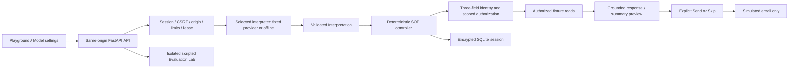

# ClaimFlow implementation — V1 core and V2 providers

One FastAPI process serves a React/Vite build and same-origin JSON API. SQLite stores encrypted session state; no framework, vector store, queue, or external database is required. The six original fixtures remain byte-identical under `docs/fixtures/`; the Docker image copies that directory explicitly.

The [Render hosting profile](DEPLOYMENT.md) uses one Docker instance and a persistent disk. Production accepts exact HTTPS origins from `ALLOWED_ORIGINS`, or Render's trusted `RENDER_EXTERNAL_URL` when no explicit list is set; invalid or missing production origins prevent startup. API documentation and the OpenAPI schema are disabled publicly. Deployment remains a manual dashboard action.

## Turn boundary

1. `main.py` checks session ownership, CSRF, origin, request size, deduplication, version, and a durable 45-second lease. It applies persistent rate limits and reserves the model budget before live calls.
2. `interpreter.py` uses OpenAI Responses structured parsing into the Pydantic `Interpretation` schema, with a 30-second overall timeout, no automatic provider retries, no tools, and `store=False`. V2 adds the curated provider adapters described below. Callers select only catalog models; all endpoints are fixed. Only the current message and bounded safe context are sent. The offline adapter is a limited regex parser; policy evaluations use explicit scripted interpretations.
3. `identity.py` accepts candidates only when their values have matching source evidence in the current message. Normalization handles explicit dates, phone formatting, case/space differences, and approved stored aliases. Three distinct categories must match one unique person with no active contradiction. Failed verification exposes no partial matching count or fields, and transcript redaction uses supplied extraction/generic patterns rather than fixture membership. Policy number locates/restricts a candidate but never contributes a match.
4. `controller.py` merges provenance, retains early topics/hints, evaluates authorization, resolves authorized cases, renders selected factual guidance, and creates versioned summaries. It can advance multiple ordered transitions in a turn. Emotion selects a short empathetic preamble. Model output cannot declare identity, grant authority, choose arbitrary actions, or generate factual prose.
5. `fixtures.py` validates actual fixture models and is the sole claim read boundary. Every session read checks identity, expiry, party ownership, and representative grant scope. Models and the inspector do not receive the fixture dataset. The explicit synthetic demo-starter endpoint exposes only the assignment's fictional starting identity for reviewer exploration; it is not an account lookup endpoint.
6. `store.py` atomically commits state, responses, audit events, and request fingerprints. Model calls run outside transactions. Stale leases/results cannot overwrite a newer turn. Duplicate committed requests return the current safe view, rather than replaying an old protected snapshot after authorization expiry.

Referenced audit events record their owning party internally and are visible only to that verified party. Legacy events without ownership keep their stored data but hide references in the Playground. Expiry clears claim hints and intent as well as identity, protected messages, summaries, and discussion memory; invalid representative grants also revoke the view.

All private session payloads, including candidates, are Fernet-encrypted at rest. Request fingerprints use keyed HMAC rather than exposing low-entropy identity hashes. Operational access logs contain route/status metadata only. Persisted transcripts and API session views redact extracted identity and recognizable credential formats; do not treat redaction as general-purpose PII detection. No analytics or raw prompt logging is installed.

## Consent and representative proof

Representative relationship data provides a hint only. Public chat cannot install a grant. The isolated evaluator binds the supplied status sequences explicitly to representative authorization and injects both an independent mock principal assertion and an expiring `claims:read` grant. That grant omits email scope, which is tested separately. This is not real identity proof and does not authorize the public caller David.

Email uses a separate explicit POST action for Send or Skip, protected by CSRF and authorization. The immutable preview UUID binds its content, masked on-file recipient, and expiry in the stored session; the request cannot supply alternate content or recipient. A new preview has a new UUID. The server rejects expired/stale offers. Successful simulation and receipt are committed in the same transaction, so retries cannot duplicate that simulated action. Failed/time-out simulator branches are available in deterministic evaluations; the public simulator normally succeeds and never contacts an email service.

New questions invalidate all current summaries, including previously simulated-sent previews. The historical send event remains; the next preview has a fresh ID and requires a new choice. Summaries cover the authorized cases actually discussed, using the evidence for each case. Structured summary cases and their text serialization share the same authorized records and preserve separate status, payment, denial and deadline facts. Detailed guidance remains in the transcript; unresolved/action limitations are expandable. No verification credentials appear in a summary. A real email integration would require a durable outbox, recipient verification, provider idempotency, and handling unknown external delivery results; this simulator does not claim those properties for real delivery.

## Grounding and data conflicts

Claim-specific facts and deadlines take precedence over generic follow-up guidance. An expired appeal receives explicit human-review wording, never a newly invented window. `pathology report` maps to the supplied `original pathology report` guidance while preserving its conditional original/scan rule. `office note` maps to `treating provider office note`. Unmapped diagnosis reports use generic guidance. Money uses Decimal and the supplied field meanings. No automatic claim mutation, document submission, or real escalation exists.

## UI and evaluation

React owns rendering and draft input; the backend owns all workflow state. Synchronizing a replaced session invalidates outstanding turn responses so obsolete success/error/finally updates cannot restore protected content or alter a newer operation. Settings and Lab synchronization require explicit re-apply/rerun and preserve unfinished drafts. Radix implements main tabs, evaluation tabs, and dialogs, including explicit focus restoration for the mobile inspector. The composer remains fixed while chat and desktop inspector scroll independently. Mobile Evaluation Lab uses one outer results scroll region with a bounded scenario picker. Prompt suggestions are deterministic frontend choices from the public session state; text chips only fill/focus the draft, and form chips open the existing verification form. They make no request or model call and cannot grant access or execute summary consent. Standard and expanded layouts retain the same mounted conversation/form components and independent scroll regions. Scenario selection inserts a draft only; the fixture-backed starter endpoint provides Standard Claim, Frustrated Caller, and Ambiguous Claim. New session requires confirmation for an existing conversation or draft, and model apply requires a reset acknowledgment for an existing conversation. Dialogs restore focus, and settings/scenario catalog failures provide local retry controls. Summary scrolling also accounts for the consent timer becoming ready so Send/Skip remain in view. The browser uses the server timestamp to expire visible authorization/consent offers; server checks are authoritative. It immediately hides protected content when authorization expires or a request returns 401, even if its refresh cannot reach the server. The composer clears immediately. Only fixed non-identity questions may render optimistically; all other outgoing messages use a neutral placeholder until server confirmation. A separate page-memory map overlays only locally submitted user text after a response contains its matching user-message/request ID. Optional Form supplies a local labeled rendering of exactly its submitted values. This map never changes the session object, Inspector, API payloads, audit events or persisted transcript and uses no browser storage. It does not inspect fixtures or verification success. Hide submitted details discards the map. Refresh, New Session, successful model reset, authorization expiry/recheck, representative blocking and 401/403/409 recovery discard originals; session/model/reset-event scoping also prevents stale overlays from rendering against a new context. New submissions can create new overlays after hiding. Failure restores the original draft. Retry retains the request ID and message, including after a lost committed response, and a conflict refreshes the expected state version. Pending turns hide the old summary. Playground source labels are readable; the Inspector retains original references and the full timestamped history behind disclosure controls.

`evaluation.py` is shared by pytest, the CLI, and the Lab. The 23 scenarios check event deltas, explicit action outcomes, locked public views, and deduplication per preview. Runs are isolated, fixed-clock policy tests with sanitized traces and expected/observed assertions. They do not call the live model or modify a customer session. `scripts/evaluate_live.py` retains the original six-call opt-in probe; `scripts/evaluate_v1_acceptance.py` contains the separate 12-call acceptance suite. Live quality is not inferred from deterministic results.

## Operational limits

The optional verification form uses `/api/verify` and the existing turn lease, limits and controller identity gate, without model inference. A separate `assistance_paused` flag preserves the SOP phase while an explicit human request pauses chat; it provides no handoff or authorization. Session recovery synchronizes stale CSRF/version state only on explicit operations and has no hourly new-session creation cap; other operation limits remain enforced. See [usage and recovery](USAGE.md).

This is a single-instance demo with lazy retention cleanup, conservative proxy rate limits, bounded model tokens, and no separate worker. All in-flight work can be recovered after its lease expires; previous committed messages survive process restart. Authorization is independently checked after model work and on every action/read. Active grants are evaluator-only, not an externally revocable authorization service. A production system needs real authentication, stronger representative proof, approved retention and insurer rules, real action integrations, and availability/backup procedures.

See the [current review](VALIDATION.md) for reproduced findings, validation evidence and remaining limits. The public starter and Lab intentionally expose fictional fixture examples and must not be used as access paths for real customer data.

## V2 model boundary and settings

`providers.py` defines the small `Interpreter` protocol, curated provider/model catalog, native Claude/Gemini adapters and shared decoder schema. OpenAI retains Responses/Pydantic parsing, a versioned extraction prompt, `store=False`, low reasoning effort and 2,200 output-token limit. Claude uses Messages `output_config.format`, low effort, and discards thinking blocks; Gemini uses GenerateContent JSON `responseFormat`. All outputs pass the original strict Pydantic Interpretation validation; refusal, truncated/malformed output and missing/invalid token accounting fail closed. Unsupported decoder constraints are carried in schema descriptions and still enforced locally. Hosts are fixed; redirects and arbitrary endpoint/model selection are disallowed. No provider tools or model-generated claim prose are introduced.

**Decision:** small native adapters over LiteLLM. LiteLLM offers unified routing for many providers plus optional gateway/proxy features; this application needs three fixed endpoints and one schema. Keeping OpenAI's existing SDK and using the already installed httpx for the other two adds no dependencies and keeps request/response contracts visible. Sources checked October 16, 2026: [LiteLLM](https://docs.litellm.ai/docs/), [OpenAI structured outputs](https://developers.openai.com/api/docs/guides/structured-outputs), [Claude structured outputs](https://platform.claude.com/docs/en/build-with-claude/structured-outputs), [Gemini structured outputs](https://ai.google.dev/gemini-api/docs/generate-content/structured-output?hl=en). Catalog IDs come from provider model documentation; Claude/Gemini are contract tested, pending keyed live acceptance. Model selection is not a claim that every provider has passed the OpenAI corpus.

`settings.py` validates credentials/catalog choices without importing the controller. A same-origin CSRF-protected settings mutation obtains the same durable session lease/version as chat and actions. It validates a connection with one schema-constrained call using an empty synthetic context. Only success commits the selection and a fresh workflow: identity, conversation, hints, claim access and consent are reset. Turn/identity-attempt counters and durable request deduplication survive switching. An in-flight turn blocks switching and vice versa; stale versions cannot apply. Failed validation leaves prior state intact. No fallback provider is selected silently.

`APP_ENV=production` forces an offline default, disables backend environment credentials, and rejects restored selections that depended on those credentials. Live public sessions require BYOK. Private development may reuse configured environment keys; settings show the current and default models separately from connection validation. Backend environment keys stay server-side. BYOK secrets enter only a password input and POST body, are cleared from the input on submission/close, and are stored only inside the encrypted session payload, excluded from every public response and model context. Revalidation requires re-entry. New session deletes the old row and resets the workflow. BYOK selection survives with its key only when retention was explicitly enabled; otherwise the key is removed and live use stays blocked until revalidation or an offline switch. Other selections return to the server default; retention/encryption/backups follow existing session rules. Database/WAL backups may retain encrypted historical payloads. This is backend-managed session storage, not an external secret vault. FastAPI validation errors use a generic response rather than echoing invalid secret-bearing inputs. HTTP access logs carry no request bodies. Do not enable third-party debug/body logging when handling keys.

Connection probes and chat share two model slots, the 30-second overall deadline, provider 25-second timeout/no retries, fixed hosts, persistent 12,000-token reservation, and global daily token cap, including BYOK. Uncertain failures keep their reservation; successful calls settle against reported usage using the reservation's day. GET settings never makes paid calls. Scripted evaluation remains isolated and provider independent. `/api/health` reports the server default; the session/settings endpoints report the caller's selected model.
