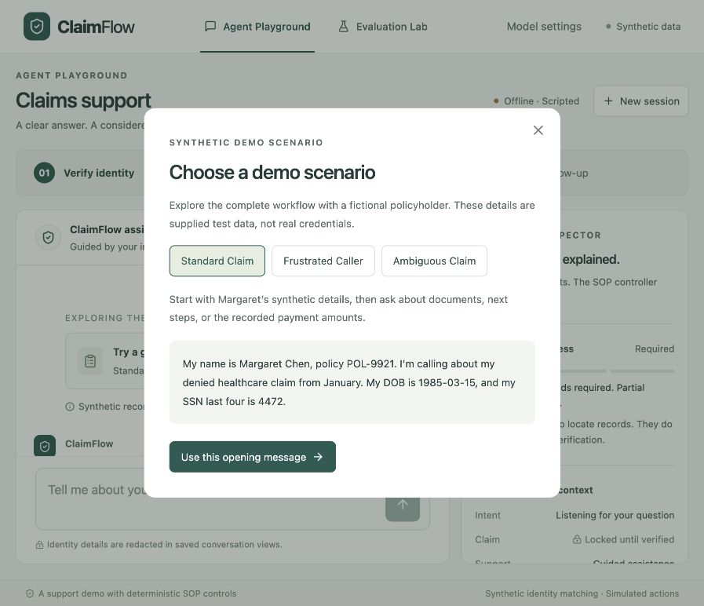
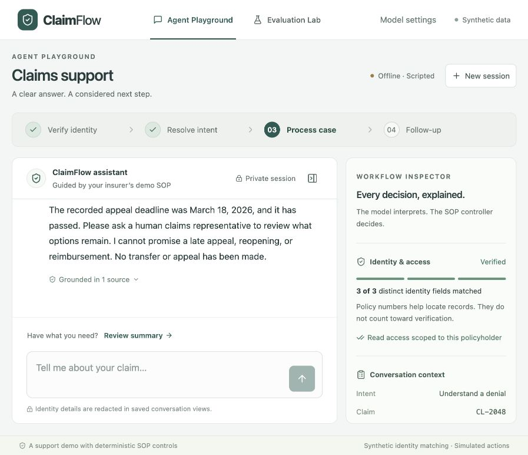
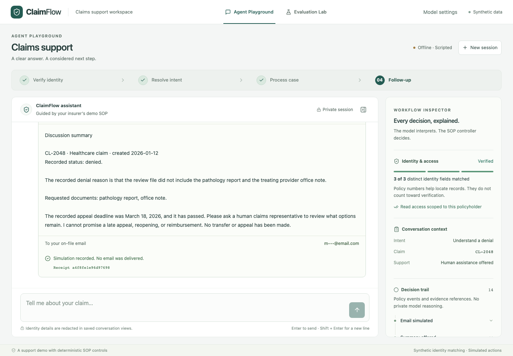
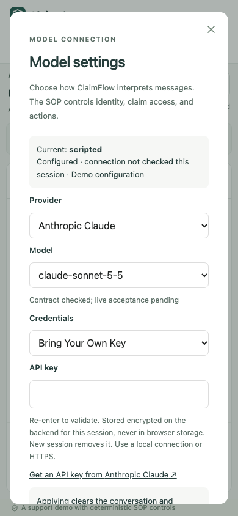
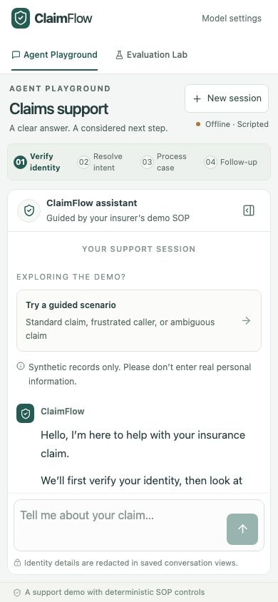

# Final validation — October 16, 2026

> Historical acceptance before the October 17 refinement. See [post-UAT implementation and current validation](POST_UAT.md) for the changed conversation, settings and evidence UI.

**Accepted for the documented synthetic portfolio demo.** The integrated `main` baseline was `52d9cfd` (V2 merged). Its tree matched the initial working branch; local `main` was fast-forwarded before changes. Baseline: 93 backend tests and 23 policy scenarios passed. Final: **96 backend tests, 23 policy scenarios, TypeScript/Vite build, and 11 Docker browser tests passed**. This is bounded developer acceptance, not a production or comprehensive accessibility certification.

The canonical assignment is [`requirement.md`](../requirement.md), singular; no `requirements.md` exists. It was left unchanged. Machine-readable results and implementation hashes are in [final-validation.json](evidence/final-validation.json).

## Requirement coverage

| Assignment requirement | Result and evidence |
| --- | --- |
| Fixed `VERIFY_ID → RESOLVE_INTENT → PROCESS_CASE → POST_PROCESS` workflow | Pass: controller transitions, shared `margaret` scenario, complete HTTP/browser journeys. A single turn can make multiple ordered transitions. |
| At least three distinct approved identity fields before claim access | Pass: threshold, partial/mismatched values, policy-only attempts, corrections, aliases and alternate IDs covered by controller/policy tests. Partial matches remain private. |
| Natural clarification, partial answers, refusals and alternate fields | Implemented within bounded interpretation: deterministic recovery tests plus retained 12-call OpenAI acceptance. Offline regex parsing has limited language support; this run does not establish broad live quality. |
| Remember early intent, case hints and questions without advancing early | Pass: `partial`, `documents`, `margaret` and controller tests; the supplied opening resolves CL-2048 after verification without restarting the question. |
| Resolve ambiguity and answer from authorized data | Pass: `january`, `cross-party`, representative scope, expired deadline, document alternatives and monetary distinctions. The model interprets; factual wording is rendered by the controller. |
| Offer summary with outcome and follow-up; allow Send or Skip | Pass for the documented simulation: preview, explicit choices, expiry, deduplication and fresh consent after further questions. Real email delivery is not implemented. |
| Politely reject unrelated questions; offer human support after retries | Pass: `scope`, injection/privacy and controller regression checks. Human support is offered; no actual transfer is performed. |
| Emotional-support/SOP-recovery bonus | Pass within the scoped demo: emotion preambles, privacy rationale, alternate identity fields, explicit human requests and exhausted document alternatives. Existing live evidence includes frustration/refusal, anxiety and confusion; no new emotion-accuracy estimate is claimed. |
| Docker/repository with clear setup, model API auth token, text UI, full journey | Pass: final Linux/ARM64 image, README setup, configured-key and BYOK contracts, real browser journey. A hosted URL is optional under the assignment and has not been provisioned. |
| V2 authentication, permission isolation, consent, model switching and BYOK regression | Pass: 96 backend tests and 11 Docker browser tests; successful apply resets authorization/consent, failed validation preserves state, encrypted persistence and no browser-storage keys. Claude/Gemini live acceptance is pending. |

## UI acceptance: steps and screenshots

1. **Start / choose a scenario — pass.** Standard Claim, Frustrated Caller and Ambiguous Claim insert editable synthetic text without sending. The entry now appears before the long welcome, including on mobile. Escape restores the trigger; applying an opening focuses the composer. The frustrated path provides expandable synthetic identity details. A failed scenario load can be retried inside its dialog.

   

2. **Verify / resolve / process — pass.** Standard opening verifies and resolves the denial; ambiguous opening leaves two authorized choices. The frustrated opening stays locked and acknowledges frustration. Case status, requested documents, expired appeal deadline and source references remain deterministic. Conversation text is 15px; summary/replay text is 14px; supporting text uses a consistent 11–13px scale.

   

3. **Review / Send / Skip / resume — pass.** Long summaries remain inside chat while the composer stays available. A reproduced timing issue could leave consent buttons partly clipped when the offer countdown initialized; scrolling now tracks that initialization, and the browser suite requires both buttons fully inside the viewport. Reading upward during an incoming response preserves position and shows New message. Send and Skip are separately exercised, and a simulated receipt/conversation survived container recreation.

   

4. **Settings / reset / error recovery — pass.** Existing conversations require a reset acknowledgment before model apply. New session offers Keep conversation and Start new session, restoring focus after cancellation. Missing demo keys offer Use my own key directly. Catalog failure and BYOK rejection have explicit recovery; rejected secrets are cleared and absent from browser storage. Desktop and mobile dialogs were inspected; long mobile settings scroll internally to their action.

   

5. **Mobile / short viewport / Evaluation Lab — pass for checked cases.** Automated Chromium covered 1440×1000, 390×844, 320×568, 390×500 and 720×450. The 720×450 case approximates the reduced CSS viewport of desktop zoom; it is not a native zoom test. Chat remains bounded, mobile input is 16px, workflow labels wrap, and inspector focus returns after Escape. Mobile Lab uses one scrolling result region plus its bounded scenario picker; running/resetting a scenario works at each small size. HTTP 401, authorization expiry with failed refresh, network retry and safe draft retention also pass.

   

   

## Findings closed

- A stale local backend served the new frontend but returned 404 for Settings. Restarted localhost:8000 with current code; health and all three starter IDs were checked. Existing `.env` and session data were preserved.
- Increased tiny functional text and control targets; retained the existing two-panel layout, independent chat/inspector scrolling and mobile inspector dialog.
- Reworked the narrow header into two rows, wrapped workflow labels, and removed the minimum page height that prevented short-viewport use.
- Moved scenario discovery above the welcome text; added three fixture-backed presets without a new parser or model calls.
- Added explicit reset safeguards, missing-demo-key BYOK action, catalog retry and dialog focus restoration.
- Fixed the summary-countdown scroll issue; retained reading position during incoming content.

## Reproduction and evidence

```sh
.venv/bin/pytest
.venv/bin/python -m backend.evaluation --output data/final-policy.json
npm --prefix frontend run build
# Against a fresh isolated Docker project/volume configured as described below:
cd frontend
CLAIMFLOW_E2E_URL=http://127.0.0.1:18085 \
PLAYWRIGHT_BROWSERS_PATH=/private/tmp/claimflow-browsers npm run test:e2e
```

The Docker run used the supplied `compose.yaml` plus a temporary override: a loopback port, `env_file: !reset []`, `MODEL_MODE=scripted`, `APP_ENV=development`, an exact loopback `ALLOWED_ORIGINS`, empty provider keys, and a new project/volume. This preserves normal application limits and avoids `.env` injection. Use a fresh isolated project for each full run: eleven browser contexts plus the reset check use the real twelve-session/hour budget. Do not browse that test instance concurrently. An initial combined manual/automated run exhausted that quota (10/11 passed); dedicated test instances then passed 11/11, including the final image after the last fixes. One temporary project initially collided with the occupied preview port; it was moved to a separate loopback port before testing.

Final image: `claimflow:final-validation`, Linux/ARM64, `sha256:152f34f61ca8583b4651951a5710ccdf7520ef204b2196add0e4f68c03657eaf`. Docker health is healthy; UID 10001; no `/app/.env` or configured provider key in runtime; encryption-key permissions 0600. Actual configured key values were checked absent from built frontend assets without printing them. A recorded synthetic receipt, conversation and offline selection remained after recreation of the manual container with its volume retained. Screenshots above were saved and visually inspected; raw runtime reports, traces, sessions and keys remain ignored.

One existing Starlette TestClient/httpx deprecation warning remains. No dependency changes were needed.

## Targeted live acceptance and limits

**Zero new paid calls.** Prompt, controller/factual phrasing, provider adapters, identity logic and fixtures are unchanged from integrated main; only demo-starter metadata and UI behavior changed. The retained [12-call OpenAI acceptance](evidence/v1-live-acceptance.json) and [V2 HTTP smoke](evidence/v2-openai-smoke.json) are historical evidence reused for those unchanged paths, not new unseen evaluation. The new starter texts were checked against the actual offline HTTP workflow, not newly live-tested.

OpenAI is configured locally. No Anthropic or Gemini key is configured; each remains **Pending: keyed complete journey plus failure path**. Their mocked contract tests still pass. No paid probe was attempted using a fake BYOK key; browser rejection is intercepted and backend provider failures are mocked.

Actual iOS/Android software-keyboard behavior, native browser zoom, screen-reader use, comprehensive focus/contrast auditing, human first-use comprehension, sustained load, public HTTPS/proxy behavior, AMD64 execution, and real insurer identity/representative authority/delivery remain unverified. Long factual responses are still verbose; semantic status/deadline/document cards and natural-response rewriting were deferred to preserve source-grounded wording in this validation round. No public deployment, multi-agent framework or architecture migration was introduced.
